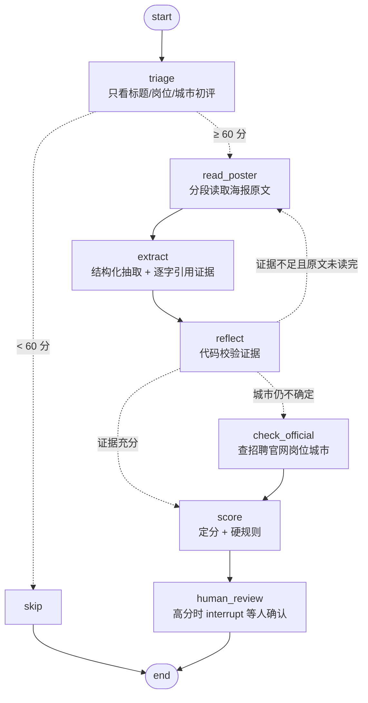

# 校招简章精读 Agent（LangGraph）

把「判断一份校招简章值不值得投」从**单次 LLM 打分**重构为**有状态的多步 Agent**：先初评，再分段精读海报原文、用代码校验模型给出的证据、必要时查询招聘官网的岗位城市，最后定分；高分岗位通过 `interrupt` 交给人确认。

在 76 条人工精读标注的简章上，经过三轮迭代：

| | 单次打分（baseline） | LangGraph Agent |
|---|---|---|
| 「值得投」F1（最佳阈值） | 0.49 | **0.74** |
| 「值得投」精确率 / 召回率（同上阈值） | 34% / 87% | **62% / 91%** |
| 深圳岗位判断：给出结论时的准确率 | 69% | **92%** |
| 实习招聘识别召回率 | 100% | 85% |

> 背景：我在秋招期间用一个校招信息看板每天抓取 2000+ 条简章（另一个项目），初版用「看板元数据 + 一次 LLM 调用」打分，经常把**实习招聘**、**对口岗位不在目标城市**的简章误判为高分。这个项目是对那一步的重构和量化评测。

## 流程



| 节点 | 做什么 | 设计要点 |
|---|---|---|
| `triage` | 只看看板元数据打分 | 条件边：明显不相关的直接结束，精读成本只花在候选上 |
| `read_poster` | 每次读 2500 字海报原文（正文 + OCR） | 大多数简章第一段就够；证据不足时才回来多读，形成**循环**（上限 3 段） |
| `extract` | 抽取是否实习、深圳有无岗、毕业要求、对口岗位，并逐字摘抄证据 | 区分**岗位级**证据（岗位本身写了深圳）和**公司级**证据（深圳只在公司城市列表里） |
| `reflect` | 校验引用是否真出现在原文、关键判断是否有依据 | **用代码校验，不再问模型**——「引用是否在原文里」可以确定判断，可靠且零成本 |
| `check_official` | 查招聘系统里每个岗位的城市 | 工具通过 **MCP** 调用（见下文）；模型只负责「挑对口岗位」，岗位名是否存在、城市是否含深圳都由代码判断 |
| `score` | 结合以上信息定分 | 硬规则兜底：实习最高 30 分，确认不在深圳最高 60 分 |
| `human_review` | 定分 ≥ 85 时 `interrupt()` 暂停 | 配合 `SqliteSaver`，人确认后从断点继续，前面的模型调用不重跑 |

## 迭代过程

完整数字见 [`results/report.md`](results/report.md)。

**第一轮：加入精读。** 单次打分看不到简章原文，实习招聘、岗位在其他城市都发现不了。加入「读原文 → 抽取 → 校验」后，「值得投」精确率从 34% 升到 54%。

**第二轮：区分证据级别。** 错例分析发现，海报上「工作地点：北京/上海/深圳…」通常是公司整体的招聘城市，对口岗位本身可能不在深圳（如某公司的 Agent 岗只在北京/杭州）。加入 `shenzhen_scope`，公司级证据降级为「不确定」。结论准确率升到 100%，但覆盖率降到 14%——说明**只读海报有天花板**。

同时修正了指标：把 `unknown` 当作「判错」会惩罚谨慎，改为分别统计**覆盖率**（敢下结论的比例）和**结论准确率**。

**第三轮：加入官网查询工具。** 对城市仍不确定的简章，查招聘系统里每个岗位的城市（目前支持北森/zhiye，公开 JSON 接口）。覆盖率 14% → 30%，准确率 92%。

Moka 的岗位接口返回加密数据，属于对方的反爬保护，**没有去破解**，这类简章保持「不确定」交给人工核实。

## 对比实验：换更强的模型有用吗？

流程不变，只把 DeepSeek V4.1 Flash 换成 V4 Pro：

| | 「值得投」F1（阈值 75） | 最佳 F1 | 深圳 覆盖率 / 准确率 |
|---|---|---|---|
| 单次打分 · Flash | 0.49 | 0.49 | 98% / 69% |
| 单次打分 · Pro | 0.48 | 0.48 | 98% / 70% |
| Agent · Flash | 0.52 | 0.74 | 30% / 92% |
| Agent · Pro | 0.62 | 0.63 | 30% / 92% |

- 只看元数据时，换强模型**没有任何提升**：信息不够，模型再强也判断不出「这是实习」。
- 深圳判断两种模型完全一致：这一项由工具和规则决定。
- Agent 换 Pro 后打分整体偏高（阈值 75 下更好），但最佳 F1 没有提升。

结论：**瓶颈在信息获取（OCR 质量、能查哪些招聘系统），不在模型大小**，因此选用更便宜的 Flash，把精力放在接入数据源上。

## 已知局限

- **样本小**：76 条，其中「值得投」正例 23 条，1 条判断的变化就会让召回率变化约 4%；以上差异未做显著性检验。
- **阈值在同一份数据上选取**（65），有过拟合风险，需要用之后新增的简章做验证。
- **模型输出有随机性**：即使 `temperature=0`，同一条简章不同轮次的结果也会有差异，正式结论应多次运行取平均。
- **标签来源**：标签由人工（借助强模型）精读海报并查询官网得到，代表「人工核实后的判断」而非绝对真值；少数条目存在争议（如「AI 应用工程师（智能座舱）」是否算对口）。
- **招聘系统覆盖**：官网查询目前只支持北森；字节、腾讯等自建系统和 Moka 未覆盖。

## 工具通过 MCP 接入

官网查询工具做成了一个 MCP Server（`mcp_server.py`），Agent 通过 MCP 客户端（`mcp_client.py`）调用它，而不是直接 import：

```
check_official 节点 ──MCP 客户端──stdio / JSON-RPC──▶ campus-ats Server ──▶ ats.py ──▶ 北森公开接口
```

- **解耦**：要支持新的招聘系统（Moka、飞书……），新增一个 Server 即可，Agent 代码不用改。任何 MCP 客户端（Claude、Cursor 等）也能直接使用这个工具。
- **工具 `lookup_jobs(apply_url)`**：返回结构化结果 `{status: ok | unsupported, jobs: [{name, cities}]}`。标注为只读、幂等、会访问外部网站（`read_only_hint` / `idempotent_hint` / `open_world_hint`）。
- **调用由代码决定**：要不要查官网由 `reflect` 后的条件边决定，节点里直接调用工具，不让模型去选。MCP 解决的是「工具怎么接入」，Function Calling 解决的是「模型选哪个工具」，这里只需要前者。
- **一致性**：评测集里 9 家北森公司，通过 MCP 和直接调用 `ats.py` 的结果完全一致。每次调用会启动一次 Server 子进程（约 0.4 秒）；`ATS_TRANSPORT=local` 可以切回直接调用。

## 运行

```bash
python3 -m venv .venv && .venv/bin/pip install -r requirements.txt
cp .env.example .env            # 填入 DEEPSEEK_API_KEY
.venv/bin/python run_one.py 44275          # 单条演示：逐节点打印执行过程，高分时暂停等确认
.venv/bin/python eval.py --limit 5         # 先试 5 条
.venv/bin/python eval.py                   # 完整评测，结果写入 results/report.md
MODEL=deepseek-v4-pro .venv/bin/python eval.py --tag _pro   # 模型对比实验
```

DeepSeek V4 默认开启推理模式，而推理模式不支持强制工具调用（结构化输出需要），代码里通过 `extra_body={"thinking": {"type": "disabled"}}` 关闭；另外 DeepSeek 不支持 OpenAI 的 `json_schema` 响应格式，所以结构化输出用的是 `method="function_calling"`。

## 文件

| 文件 | 说明 |
|---|---|
| `agent.py` | State、节点、条件边与循环、interrupt |
| `ats.py` | 招聘官网查询工具（北森），含短链接跳转解析与结果缓存 |
| `mcp_server.py` | 把 `ats.py` 包装成 MCP Server（工具 `lookup_jobs`，结构化输出 + 工具标注） |
| `mcp_client.py` | Agent 端的 MCP 客户端：stdio 启动 Server、握手、调用工具 |
| `baseline.py` | 对照组：只看元数据的单次打分 |
| `eval.py` | 评测：多方法对比、阈值扫描、错例列表 |
| `run_one.py` | 单条演示，带 `SqliteSaver` checkpointer 和人工确认 |
| `build_dataset.py` | 从主项目数据库导出评测集 |
| `data/eval.jsonl` | 76 条评测数据（公开的校招简章内容 + 标签） |
| `profile.example.json` | 示例候选人画像（实际使用时通过 `PROFILE_PATH` 指向自己的） |
